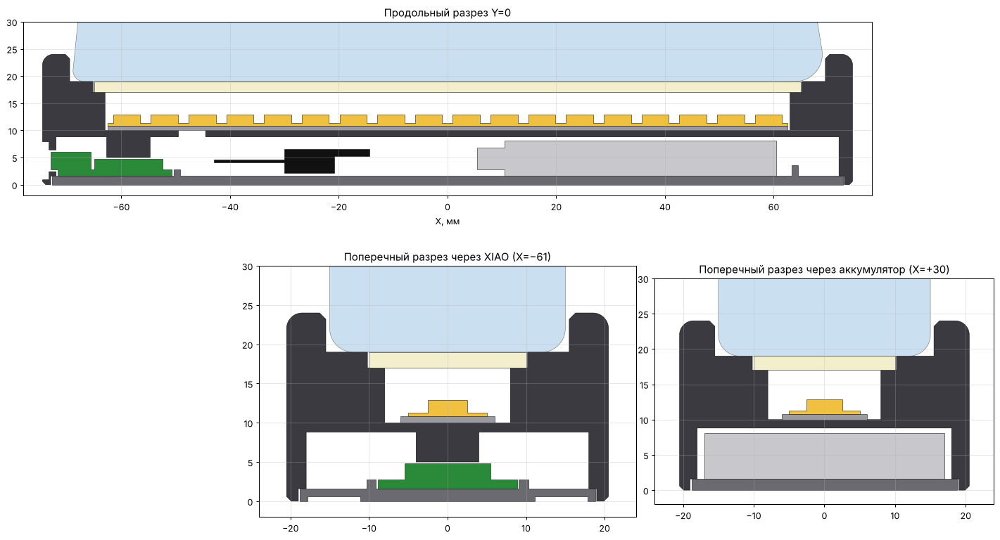

# Ночник-подставка для стеклянного блока

Подставка с подсветкой для гравированного стеклянного блока (≈137.8 × 30 × 104.6 мм).
Свет идёт снизу через опаловый рассеиватель и шершавое дно стекла и подсвечивает матовую гравировку.
Питание от плоского LiPo, управление — сенсорная кнопка и Bluetooth (цветные эффекты).



## Состав

| | |
|---|---|
| Контроллер | Seeed XIAO nRF52840 (BLE, встроенная зарядка) |
| Свет | SK6812 RGBW 144/м, 18 пикселей, питание прямо от Li-ion |
| Питание | LiPo 603450, 1000–1200 мА·ч |
| Ключ ленты | N-MOSFET TO-220 (IRLB8721PbF / IRLZ44N), low-side |
| Кнопка | TTP223 + медная фольга за стенкой 1.2 мм |

Полный список деталей — [docs/BOM.md](docs/BOM.md), схема — [docs/wiring.md](docs/wiring.md),
решения и размеры — [docs/spec.md](docs/spec.md).

## Структура

```
cad/          параметрические модели (CadQuery)
  glass.py        габаритная модель стекла
  components.py   габаритные модели компонентов
  stand.py        корпус + крышка подставки (все размеры — параметры в начале)
  assembly.py     сборка + проверка пересечений
exports/      готовые STEP/STL (генерируются, но лежат в репо для удобства)
docs/         спецификация, BOM, схема, картинки
firmware/     прошивка XIAO (в работе)
```

## Сборка моделей

```bash
python3 -m venv .venv && . .venv/bin/activate
pip install -r requirements.txt
make            # glass → components → stand → assembly
```

Результат — в `exports/`. Открыть можно во FreeCAD (File → Import для сборки), F3D или слайсере.

## Печать

- `stand_body.stl` — печатать **вверх ногами** (верхняя грань на стол), поддержки не нужны.
- `stand_lid.stl` — как есть.
- Тёмный пластик: стенки световой камеры изнутри оклеить белой/алюминиевой плёнкой.

## Статус

- [x] Габаритная модель стекла (по обрисовке на клетке, точность ~±1 мм)
- [x] Подставка v1, сборка без пересечений
- [ ] Переснять контур стекла (кубики-магниты + отпечаток на миллиметровке) и обновить гнездо
- [ ] Место под TTP223 в отсеке
- [ ] Прошивка: эффекты, сенсор, таймер, BLE
